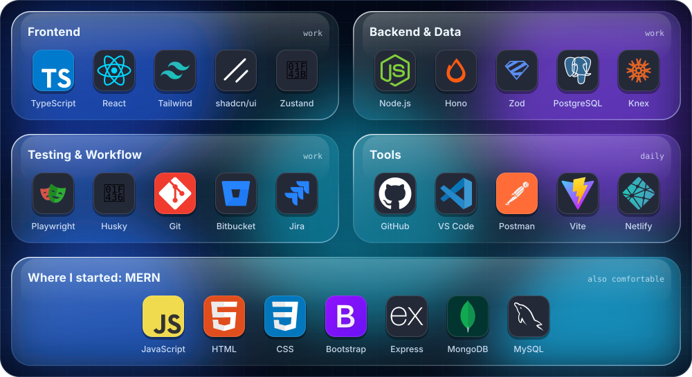

<p align="center">
  
</p>

<p align="center">
  
</p>

<p align="center">
  
  <a href="https://www.linkedin.com/in/premkumar-frontenddeveloper/"></a>
  <a href="mailto:premkumar200326@gmail.com"></a>
  <a href="https://prem2621.github.io/webfolio/"></a>
  <a href="https://leetcode.com/u/premji2003/"></a>
</p>

---

## `$ whoami`

```ts
const prem = {
  role: "Full Stack Developer",
  company: "4baseCare",               // precision-oncology health-tech
  location: "Bengaluru, India 🇮🇳",
  since: "Feb 2026",
  style: "end-to-end — frontend, backend & DB migrations, one engineer, one feature",

  stack: {
    frontend: ["React", "TypeScript", "Tailwind CSS", "shadcn/ui", "Zustand"],
    backend:  ["Node.js", "Hono", "Zod"],
    database: ["PostgreSQL", "Knex (queries & migrations)"],
    quality:  ["Unit testing", "Playwright (E2E)", "Husky git hooks", "PR reviews"],
    workflow: ["Bitbucket", "Jira"],
  },

  currentlyLearning: ["Authentication in depth", "Data Structures & Algorithms"],
  belief: "Understand the product first. Then write the code.",
};
```

---

## 💼 Currently @ 4baseCare

> [!NOTE]
> Every engineer on my team works **full stack**. I take a feature from the React UI, through the Hono API and Zod validation, down to the PostgreSQL schema and its Knex migration, and cover it with tests before it goes to review.

- ⚡ **Made the unit-test suite run faster on low-spec machines.** I found that tests running concurrently were competing for CPU and slowing the whole run down on our dev laptops. I changed them to run serially, so CPU time matched real (wall-clock) time.
- 🎯 **Introduced `data-testid`-based test selectors** to cut the time spent locating elements in tests and make them less brittle.
- 🧪 I write **unit and Playwright E2E tests** for every feature. Our team targets **at least 85% coverage**.
- 🔍 I review PRs on Bitbucket and track work in Jira.

---

## 🔍 How I Review a Pull Request

### 📖 The review comment that changed how I write code

Before 4baseCare, my form validation looked "standard":

```ts
name:       /^[A-Za-z ]+$/   // letters only
postalCode: /^\d{6}$/        // numbers only
email:      /* a strict regex copied from the internet */
```

On one of my early PRs, a senior reviewer asked:

> *"Our users aren't only in India. What happens when **José Müller**, **Siobhán O'Connor** or **Anne-Marie** types their name? What about a UK postcode like **SW1A 1AA**, or an email like **first.last+work@company.co.uk**?"*

My code would have rejected every one of them. I went back and researched how this is really handled. My "standard" regexes turned out to be **habits copied from the internet**, and they only fit the users I had pictured.

| Field | Before | What I do now |
|---|---|---|
| **Name** | Letters A–Z only | Allow any Unicode letter, plus spaces, `'`, `-` and `.` (for example `/^[\p{L}\p{M}' .-]+$/u`), with a length limit |
| **Postal code** | Exactly 6 digits | Validate per country: India is 6 digits, the UK uses letters and digits, the US uses 5 or 9 digits |
| **Email** | A strict regex | A basic format check (`z.string().email()`), then a confirmation email proves the address is real |

> [!IMPORTANT]
> **What it taught me:** there is no universal "best practice". A practice is only *best* for a particular product, its users and its market, and that changes as the product grows.
> So before I write code, I understand the product first: who uses it, where it's heading, and what the worst-case input looks like. *Then* I pick the standard that fits.

### ✅ My review checklist

1. 🎯 **Understand the "why" first.** Read the Jira ticket. Does the change solve the business requirement, and nothing extra?
2. 🧠 **Check correctness and edge cases.** Try empty, null, very large and international inputs, and check the error paths, not just the happy path.
3. 🛡️ **Validate at the boundary.** Every request is checked with Zod, and business rules are enforced, not just types.
4. 🧩 **Check the design** against the principles below.
5. 📈 **Think about scale.** No queries inside loops, lists are paginated, and new filters have indexes.
6. 🔐 **Check security.** No secrets in code, auth is checked on every route, and every query is parameterized.
7. 🧪 **Check the tests.** New logic and its edge cases are tested, and coverage stays at or above 85%.
8. 💬 **Mind the tone.** Comment on the code, not the person. Ask "what happens if…?" instead of giving orders, and mark small points as `nit:`.

### 📐 Principles I look for

| Principle | In one line | 🚩 Red flag in a PR |
|---|---|---|
| **DRY** (Don't Repeat Yourself) | Every piece of logic lives in one place | The same logic copy-pasted into two or more files |
| **SRP** (Single Responsibility) | A function or module does one job, so it has only one reason to change | One function that fetches, validates *and* formats |
| **KISS** (Keep It Simple) | Simple code beats clever code | A one-liner nobody understands without running it |
| **YAGNI** (You Aren't Gonna Need It) | Build for today's requirement, not imagined ones | Unused params, "just in case" flags, early abstractions |
| **Readable naming** | A name should explain its intent | `data`, `temp`, `flag2` instead of `pendingOrders`, `isExpired` |
| **Scalability** | It should still work with 100× the data | A DB call inside a loop, or a list with no pagination |
| **Business-logic validation** | Types check the shape; rules check the meaning | An end date before the start date gets through |
| **Coverage ≥ 85%** | Untested code isn't finished | A new branch with no test |

---

## ⚡ Tech Stack

<p align="center">
  
</p>

---

## 🔬 Currently Learning

<table>
<tr>
<td width="50%" valign="top">

### 🔐 [auth-deep-dive](https://github.com/prem2621/auth-deep-dive)

A daily, public study log on authentication, starting from first principles and working up to production. There's a note and runnable code for every day.

```
Phase 1 / 9  ▓░░░░░░░░  Foundations
```

Hands-on companion: [JWT-authentication](https://github.com/prem2621/JWT-authentication)

</td>
<td width="50%" valign="top">

### 🧠 Data Structures & Algorithms

Solving on LeetCode and keeping my solutions in [LeetCode-Mastery](https://github.com/prem2621/LeetCode-Mastery), with topic repos for [arrays](https://github.com/prem2621/DSA-Array), [linked lists](https://github.com/prem2621/linked-list), [recursion](https://github.com/prem2621/recursion) and [sorting](https://github.com/prem2621/sort-Algo).

</td>
</tr>
</table>

---

## 🌍 Open Source

| Project | Contribution | Status |
|---|---|---|
| [DulanjaliSenarathna/mern-food-delivery-app](https://github.com/DulanjaliSenarathna/mern-food-delivery-app) | [#1](https://github.com/DulanjaliSenarathna/mern-food-delivery-app/pull/1): fixed image display, **secured exposed keys**, fixed a cart-state bug, improved the README |  |
| [Mshandev/Food-Delivery](https://github.com/Mshandev/Food-Delivery) | [#4](https://github.com/Mshandev/Food-Delivery/pull/4): fixed frontend image paths, added `.gitignore`, fixed category state, improved the README |  |

---

## 🚀 Featured Project

### 🚚 [Tasty Truck](https://github.com/prem2621/food-delivery): MERN Food Delivery Platform

A full-stack food-ordering app made of **three deployed apps**: a customer storefront, an admin dashboard and a REST API.

- 🛒 Menu with category filters and search, a cart, and a checkout that sends real orders to the API
- 🛠️ Admin dashboard with product CRUD, image uploads, order-status management and summary stats
- 🔐 JWT auth + bcrypt, protected admin routes, and Cloudinary/local file uploads

<p>
  <a href="https://food-delivery-clientss.onrender.com/"></a>
  <a href="https://food-delivery-admin-qwfe.onrender.com/"></a>
  <a href="https://github.com/prem2621/food-delivery"></a>
</p>

`React` `Node.js` `Express` `MongoDB` `Mongoose` `JWT` `bcrypt` `Render`

🛠️ More hosted projects: [Netlify](https://app.netlify.com/teams/prem2621/sites) · [Portfolio](https://prem2621.github.io/webfolio/)

---

## 📊 GitHub Stats

> [!TIP]
> Most of my day-to-day commits live in private Bitbucket repos at work. What you see here is my public, learning-in-public side.

<p align="center">
  
  
</p>

<p align="center">
  
</p>

<p align="center">
  
</p>

---

## 🧩 LeetCode (live)

<p align="center">
  <a href="https://leetcode.com/u/premji2003/">
    
  </a>
</p>

---

## 🐍 Watch the snake eat my contributions

<p align="center">
  <picture>
    <source media="(prefers-color-scheme: dark)" srcset="https://raw.githubusercontent.com/prem2621/prem2621/output/github-snake-dark.svg"/>
    <source media="(prefers-color-scheme: light)" srcset="https://raw.githubusercontent.com/prem2621/prem2621/output/github-snake.svg"/>
    
  </picture>
</p>

---

<p align="center">
  
</p>

<p align="center">
  Let's talk about frontend, APIs, auth or career tips. 📫 <a href="mailto:premkumar200326@gmail.com">premkumar200326@gmail.com</a>
</p>
